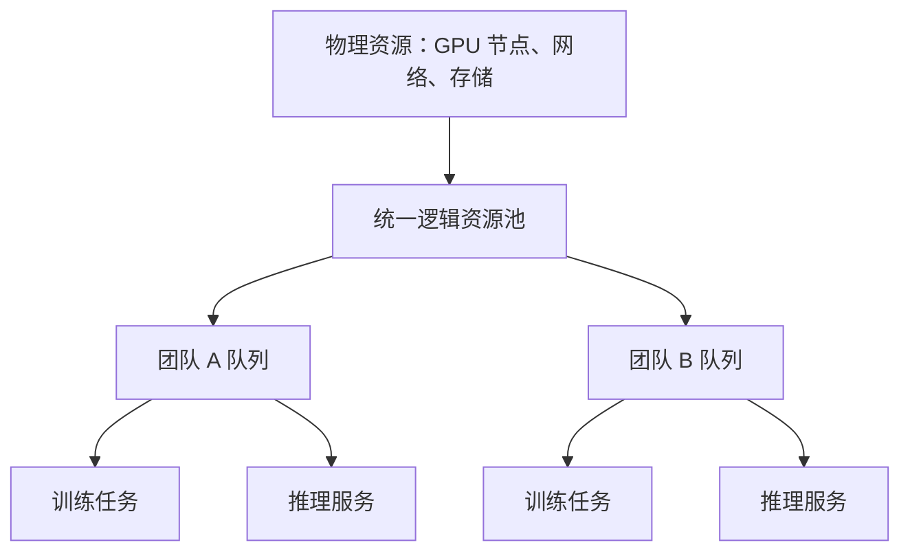

# 01 · GPU 资源池与训推一体

> 核心问题：为什么要有一个大资源池，还要在里面划分队列？

## 先看一个浪费资源的场景

假设给训练固定划 60 张卡，给推理固定划 40 张。晚上推理只需要 10 张，训练却还有任务排队。如果两个池完全隔离，就可能一边空闲 30 张，一边等卡。

共享池允许符合条件的工作负载使用这些空闲资源。它既需要管理“谁有权用多少”，也需要知道“哪些机器真的能承载这个任务”。

## 四个概念各管一件事

| 概念 | 可以怎样理解 | 关注的问题 |
|---|---|---|
| 物理资源 | 机器、GPU、网络和存储 | 卡在哪里，什么型号，节点是否健康？ |
| 逻辑资源池 | 对一组资源提供统一管理入口 | 哪些资源纳入共同管理，哪些允许共享？ |
| 资源队列 | 一组工作负载的资源权益与排队边界 | 谁应得多少，最多能用多少，谁先运行？ |
| 工作负载 | 一次训练任务、一个推理服务或一批离线作业 | 需要多少资源，能否中断，怎样恢复？ |

队列通常可以按团队、项目或服务等级划分。一个团队可以同时提交训练和推理工作负载；训推用途也可以形成不同子队列，取决于管理目标。

## 把关系画出来

图中上下表示管理关系，不是请求调用路径。队列可以有不同份额，实际运行的任务仍然要放到具体节点上。

## “训推一体”可以怎样理解

在本文的学习模型里，它表示训练和推理统一纳管，并在满足兼容性与服务要求时共享资源。至于共享到什么程度，需要继续看卡型、环境、调度器和任务控制器的能力。

例如，在线推理的工程目标可能是保护最低可用容量和响应延迟；训练则可能允许在保存进度后退出。这里的“响应延迟目标”就是服务等级目标（SLO）的一种。统一管理后，仍需要为不同工作负载配置不同规则。

不能仅凭“训练”或“推理”两个名字断定优先级：紧急训练也可能高于可延期的离线推理。这属于业务策略，需要明确约定。

## 为什么逻辑上有卡，任务还是跑不起来

想象池里还有 8 张空闲卡，分散在 8 台机器上。一个任务要求单机 8 卡，就仍然无法运行。再如，80GB 与其他显存规格的卡不一定能互换，多机训练也可能要求适合的网络互联。

因此，**配额允许进入，只解决了一部分问题；还要有满足放置条件的实际资源。** Kubernetes 调度文档也将 Pod 的节点选择作为独立环节描述。[Kubernetes Scheduler](https://kubernetes.io/docs/concepts/scheduling-eviction/kube-scheduler/)

另外，“分配了 80 张卡”不能说明“GPU 核心利用率 80%”。前者是资源占用，后者是设备忙碌程度；还应分别观察有效吞吐、等待时间和服务延迟。

## 自测

一个队列的配额剩余 16 张，集群也有 16 张空闲卡，是否足以保证一个 16 卡训练任务立刻启动？

展开参考答案

不能保证。还要检查卡型、显存、节点分布、网络拓扑、任务是否要求整组同时启动，以及镜像、存储和节点健康等条件。配额与节点放置不能相互替代。

## 对照真实平台时，先问这些问题

- 队列按团队划分，还是按用途划分？一个队列能否容纳训练和推理？
- 训练与推理是否共享实际节点，还是仅统一展示、通过转换流程调整资源？
- 哪些份额可外借，哪些受到专属保护？回收由哪个组件执行？

以上是待验证清单，不代表已确认任何公司平台的实现。

## 延伸阅读

队列如何表达资源权益，可以看 [Volcano Queue](https://volcano.sh/docs/concepts/queue/)；配额分组共享可以看 [Kueue Cohort v0.20](https://kueue.sigs.k8s.io/v0.20/docs/concepts/cohort/)。具体字段放到后面的实现对照篇。

资料核对：2026-10-22。本文图示和案例是教学模型。

[下一篇：资源调度与流量调度](02-resource-and-traffic-scheduling.md) · [返回知识地图](../README.md)
