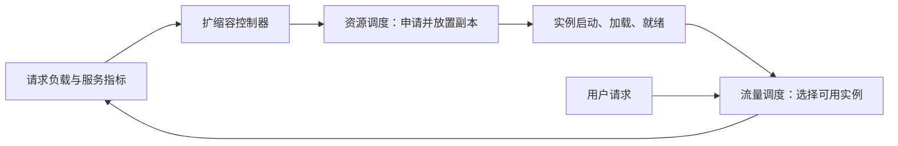

# 02 · 资源调度与流量调度

> 核心问题：给一个模型增加 GPU，和把请求发给一个模型实例，是同一件事吗？

## 用一家餐厅理解

餐厅安排多少厨师、各厨房分几个人，类似资源调度；订单来了以后，交给哪间厨房、哪个工位处理，类似流量调度。

回到推理系统：

| 维度 | 资源调度 | 流量调度 |
|---|---|---|
| 调度对象 | 任务、服务副本及其 GPU 等资源请求 | 一次模型调用、请求或会话 |
| 核心问题 | 给谁多少卡，放在哪些节点？ | 发往哪个模型、服务池和实例？ |
| 典型动作 | 排队、准入、放置、回收、抢占 | 模型选择、路由、负载均衡、准入与限流、故障切换 |
| 常见输入 | 配额、优先级、节点资源、拓扑 | 实例健康、负载、缓存、请求长度、服务目标 |

这里是职责划分；一个平台可以由多个组件合作完成某一层。

## 从一个请求看两层如何联动

假设模型服务有两个可用副本。请求到达时，网关或路由组件从这两个副本中选择一个，这是流量调度。

如果请求增加到现有副本处理不过来，扩缩容控制器可能提出增加副本的需求；资源调度再决定新副本能否获得 GPU、放在哪台机器。新副本还要加载模型、通过就绪检查并被服务发现，之后才进入流量候选集合。

图中的扩缩容控制器负责把负载变化转换成副本需求；它和资源调度器也有职责区别。Kubernetes 的 HPA 调整副本数，节点扩缩容则调整承载 Pod 的节点容量。[Kubernetes 扩缩容联动](https://kubernetes.io/docs/concepts/cluster-administration/node-autoscaling/#combine-workload-and-node-autoscaling)

## 两个容易混淆的“优先级”

“高优请求优先进入在线服务池”属于流量规则；“高优任务可以抢占低优任务的 GPU”属于资源规则。

两个系统的优先级值甚至可能采用不同方向。看到 `10`、`30` 之类的数字，要先确认所在层、数值方向和实际策略，不能直接比较。

## 为什么回收推理 GPU 要与流量配合

这是一个工程推演：如果某副本正在输出流式响应，直接退出可能中断请求。受控回收通常需要考虑停止接收新请求、处理已有请求、等待超时和释放资源等步骤；具体保证由控制器、网关和引擎共同决定。

配额变小本身不等于副本已经退出；副本退出也不等于所有请求都已平稳迁移。

## 自测

1. 把同一个请求从繁忙实例转发给空闲实例，属于哪层？
2. 新申请 8 张 GPU 启动另一个副本，属于哪层？
3. 新副本分到卡后，是否马上可以接流量？

展开参考答案

1. 流量调度。
2. 副本需求由控制器提出，资源分配和节点放置属于资源调度。
3. 不能保证；还要完成初始化、模型加载、就绪检查和服务发现。

资料核对：2026-10-22。餐厅比喻和回收步骤是解释与工程推演，不是某个产品的执行承诺。

[上一篇：GPU 资源池](01-unified-resource-pool.md) · [下一篇：配额与共享](../scheduling/01-quota-borrowing-reclaim-preemption.md) · [返回知识地图](../README.md)
